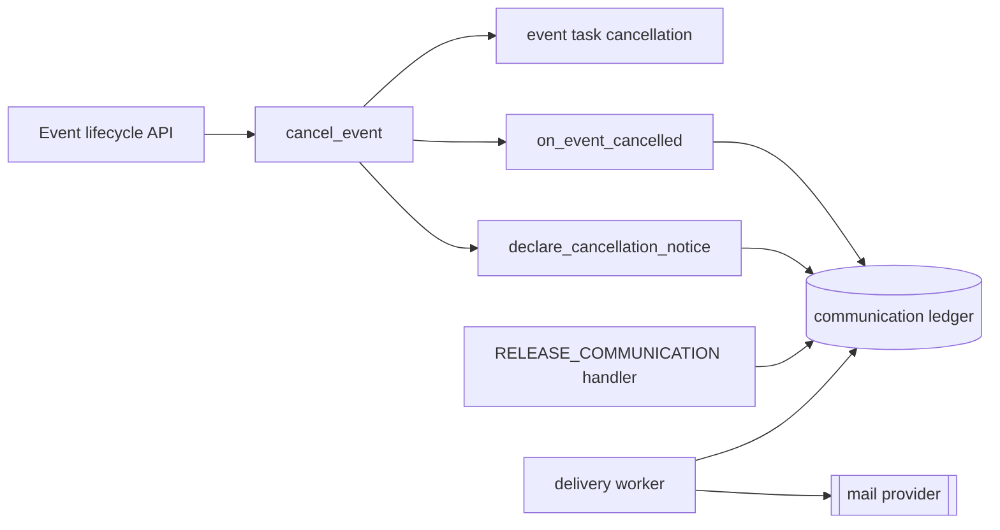
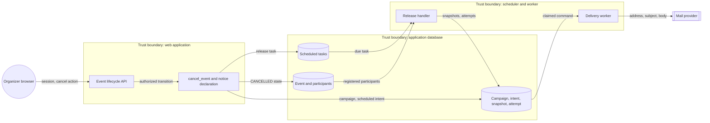
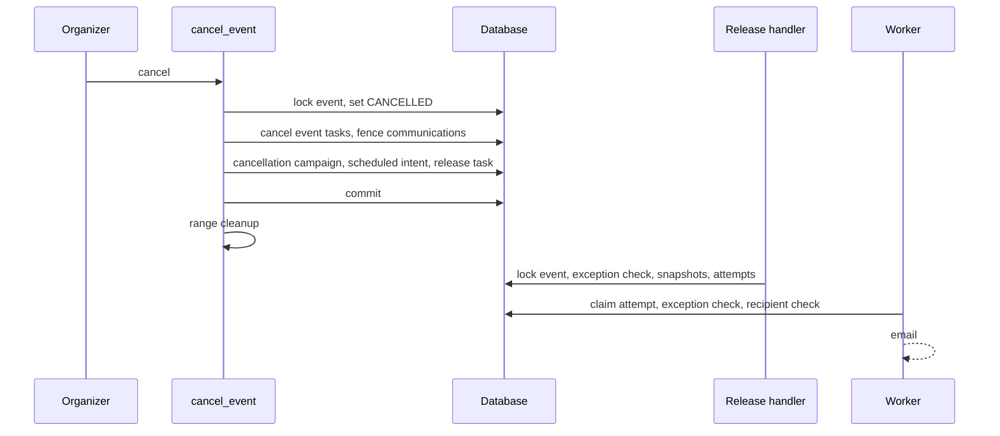

# Event cancellation notice design (#662)

Design, 2026-10-31. Scope: the CTF-706 clause "send cancellation notifications
to all registered participants". The
[preflight](../design/ctf-event-cancellation-preflight-706.md) gives the
boundaries. [ADR-065](../adr/065-retire-legacy-ctf-notification-writes.md)
revision R5 records the decision.

## Maintainer decisions

| Subject | Decision |
| --- | --- |
| Delivery contract | A `cancellation` notice kind in the existing communication ledger. |
| Durability | The cancel transaction declares the notice. A scheduled release task releases it and retries on backpressure. |
| Fence exception | One check lets only this notice pass the cancelled-event release and delivery fences. All other communications stay fenced. |
| Channels | Email, the same as the other participant lifecycle notices. |

## Architecture

The design extends the participant ledger. It adds no outbox, worker,
notification store or recipient framework.

| Component | Contract |
| --- | --- |
| `cancel_event` | Locks the event, sets `CANCELLED`, cancels event tasks and fences communications. Then it declares the notice in the same transaction. |
| `declare_cancellation_notice` | Creates one system campaign for the event and schedules its declaration. The campaign UUID derives from the event, the kind and the occurrence, so a replay returns the first declaration. |
| `ledger.declare_notice` | The shared durable declaration for a participant lifecycle notice: kind, event, stable occurrence, fixed content and the email channel. |
| `create_system_event_campaign` | Refuses a `cancellation` campaign unless the locked event is `CANCELLED`. The notice skips the shared system authoring rate budget. |
| `is_event_cancellation_notice` | The one classification of the exception: `system_milestone` origin and `cancellation` notice kind. Only `create_system_event_campaign` can set that kind, and the kind is immutable. |
| Release | `_assert_release_allowed` lets the notice through when it has exactly one target event. Declaration and due-time release both use this check. |
| Delivery worker | `_fence_reason` does not suppress the notice for its cancelled event. Campaign and intent cancellation and recipient eligibility still apply. |
| Email adapter | Renders `ctf/email/notice/cancellation` and links to the participant event page. |

### Failure behavior

- The notice declaration commits with the cancellation. A crash after commit
  cannot lose it.
- The declaration comes after task cancellation and the communication fence.
  Neither operation can remove it.
- Release-time admission backpressure reschedules the release in the grace
  window. A release past the grace window expires. It never delivers late.
- When the deployment has no email delivery, the release queues email work that
  the worker does not claim. The intent shows a `pending` disposition.
- A refused declaration is logged with its bounded code. Cancellation and range
  cleanup continue, because the refusals are permanent configuration faults.
- Range cleanup does not wait for the notice. The notice does not promise mail
  before ranges stop.

## Systems security engineering

| Asset | Protection need |
| --- | --- |
| Cancellation fence | Only the cancellation notice reaches participants of a cancelled event. |
| Participant email address | Confidential; encrypted at rest; decrypted only by the email adapter. |
| Notice content | Fixed server text. No organizer input, credentials or errors. |
| Lifecycle integrity | Cancellation completes when the notice fails. |

| Threat | Control | Verification |
| --- | --- | --- |
| An organizer sends ordinary mail to a cancelled event | Public authoring accepts the `announcement` kind only. The exception check needs the `cancellation` kind. | Release test with a system announcement for a cancelled event |
| A forged notice for a live event | `create_system_event_campaign` refuses a `cancellation` campaign for an event that is not cancelled. | Service test on a live event |
| A multi-event campaign uses the exception | Release needs exactly one target event for the exception. The system factory allows one target only. | Release check and factory validation |
| A removed participant gets the notice | Audience resolution and the worker recheck use `viewing_participant_q`. | Existing recipient fence tests |
| A replay sends duplicates | Stable campaign identity and intent idempotency key | Second cancellation request refused; release replay returns the first intent |
| Address or content leaks to logs | Reference-only commands and bounded codes | Existing adapter and worker tests |

Residual risks: email is at-least-once, so a worker crash after provider
acceptance can send a duplicate. An accepted email cannot be recalled. A
refused declaration loses the notice; the log records the code.

## Data flow

## Sequence

## Policy, architecture-as-code and ADRs

- ADR-065 gets revision R5. ADR-051-R6 and ADR-065-R3 name the exception.
- A migration adds `cancellation` to the `notice_kind` choices and the
  `ctf_comm_campaign_notice_kind_valid` constraint.
- No new import contract is necessary. The change stays in the `ctf` layer.
- No API, configuration, deployment or network change is necessary.
