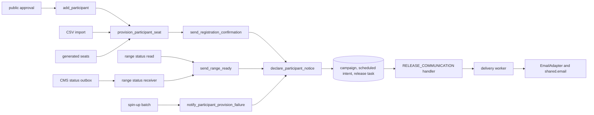
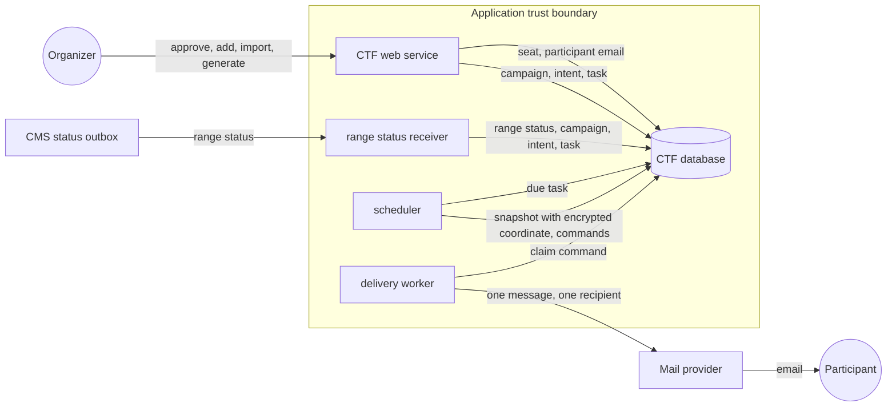
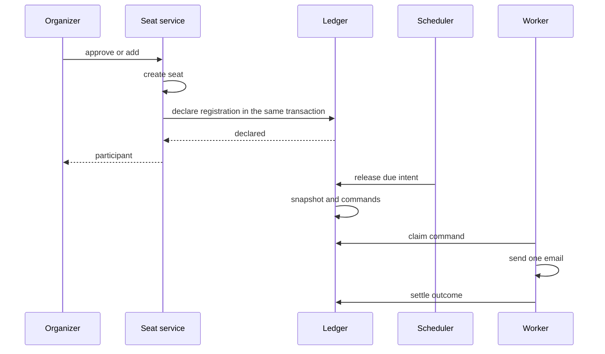

# Participant notices design (#664)

Design, 2026-10-31. Scope: CTF-801 registration confirmation, and the durable
declaration of range-ready and range-failure notices. The
[preflight](ctf-participant-email-preflight-664.md) gives the boundaries.
[ADR-065](../adr/065-retire-legacy-ctf-notification-writes.md) revision R5
records the decision. Application paths are relative to
`shifter/shifter_platform/`.

## Maintainer decisions

| Subject | Decision |
| --- | --- |
| Registration trigger | Every seat-creation path: public approval, single add, CSV import and generated seats. |
| Recipients | Only participants with a delivery email get a registration confirmation. |
| Authoring budget | Participant lifecycle declarations skip the shared system authoring rate budget. Release-time admission backpressure still applies. |
| Budget redesign | #2707 tracks a review of the budget mechanism. |

## Architecture

The design extends the existing ledger. It adds no outbox, worker, setting,
route or deployment.

| Component | Responsibility |
| --- | --- |
| `NoticeKind.REGISTRATION` | Selects the trusted pair `ctf/email/notice/registration`. A migration extends the field choices and the check constraint. |
| `notification.ledger.declare_participant_notice` | Creates one system campaign for a participant occurrence. Commits a scheduled intent and its release task in the caller's transaction. |
| `notification.delivery_milestones` | Fixed subject and body for the registration, range-ready and range-failure notices. |
| `participant.accounts.provision_participant_seat` | Declares the registration confirmation after it creates the seat. |
| `signals.sync_ctf_participant_range_status` | Declares range-ready for each `ready` status that the CMS outbox delivers. Locks the affected events before it writes participant rows. |
| `range.status.get_range_status` | Declares range-ready when a read changes the cached status to ready. |

### Identity and replay

The campaign UUID derives from the event, the kind, the occurrence and the
participant. This is the formula of `stage_notice`.

| Notice | Occurrence |
| --- | --- |
| Registration | `registered`. A range never changes it. A new participation UUID is a new enrollment. |
| Range ready | The range instance ID. |
| Range failure | The range instance ID, or `account` when no range exists. |

A replay uses the persisted due time of the campaign. A campaign from the older
inline path has a `manual` trigger. The declaration returns it as `existing` and
schedules nothing. This prevents a second email for a released notice. It also
prevents a replay of a staged draft when email becomes available.

### Failure behavior

| Condition | Result |
| --- | --- |
| Email channel unavailable | The campaign is kept. No intent is made. Outcome `channel_unavailable`. |
| Communication refusal (`CTFCommunicationError`) | A savepoint rolls back the declaration. The caller's change continues. The log records the bounded code only. |
| Database failure | The error propagates. The registration or the outbox delivery rolls back. The CMS outbox retries its delivery. |
| Lock order | Every producer locks the event before the participant, as provisioning and recovery do. This prevents a deadlock. |
| Release backpressure | The scheduler retries in the grace window. After the window, the intent is `expired`. |
| Delivery failure | The worker settles the command. Registration and range state do not change. |
| Status read declaration failure | The read logs the failure. The CMS outbox delivery declares the same notice again. |

## Systems security engineering

| Asset | Protection need |
| --- | --- |
| Delivery email | Confidentiality. Only the email adapter decrypts the snapshot coordinate. |
| Notice content | Integrity. Fixed server text and trusted templates only. |
| Registration and range state | Availability. A notice must not block or reverse the state change. |
| Shared delivery capacity | Availability. Bounded work for each tenant and for the platform. |

| Threat | Control | Verification |
| --- | --- | --- |
| Organizer selects a system kind to forge a notice | `create_campaign` refuses kinds other than `announcement`. The public API has no kind field. | Existing authoring test. |
| Mass seat creation floods mail | One declaration for each new seat by stable identity. Seat creation needs participant-management authority and event capacity. Release admission keeps the actor, workspace, global and outstanding-work budgets. | Import test. Existing backpressure tests. |
| Duplicate confirmation on replay | Stable campaign identity. Idempotent `schedule_declaration`. | Replay test. |
| Notice for a rolled-back seat | The declaration shares the seat transaction. | Rollback test. |
| Deadlock aborts a range claim | Event-before-participant lock order in the status receiver. | PostgreSQL concurrency test through the CMS delivery boundary. |
| Content or template injection | Fixed text. Escaped scalar context. Closed kind-to-path map. | Template pair test. |
| Credential disclosure | The confirmation has no password, token or login link with a secret. | Template content test. |
| Address or PII in logs | Logs record IDs and bounded codes only. | Code review. |

Residual risks:

- Release admission charges the event creator's actor budget. A very large import can expire some confirmations after the grace window. #2707 tracks the budget design.
- A participant can get a confirmation before login opens. The message states the event start time and timezone.
- Range notices have no current-generation delivery fence. The preflight records this gap.

## Data flow

| Flow | Data | Boundary |
| --- | --- | --- |
| Organizer to web service | Participant name, delivery email | Authenticated session or API token |
| Web service to database | Seat row and declaration rows | Same transaction |
| CMS outbox to receiver | Range ID and status | In-process signal in the outbox transaction |
| Scheduler to database | Recipient snapshot, encrypted coordinate, delivery commands | Release transaction |
| Worker to provider | Rendered message and recipient address | Application to external provider |

## Sequences

## Policy, architecture-as-code and ADRs

| Artifact | Change |
| --- | --- |
| ADR-065 | Revision R5 records the participant lifecycle declaration and the budget specialization. |
| `docs/adr/index.yaml` | Adds rule ADR-065-R5 and this design as evidence. |
| Policy as code | No change. No new import edge crosses a layer. `.importlinter` contracts stay. |
| Architecture as code | No change. No new component, route, setting or deployment. |
