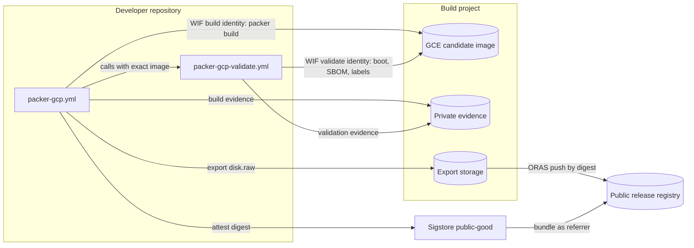
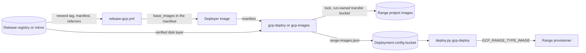

# GCP Guest Images

How BigRAE range guest images for GCP are built, validated, published, released,
and imported. The supported GCP range backend is GCE range cells, which boot
**native GCE images** directly. Issue #2668 moved image production to a
developer-supplied build project and made guest images part of the release.
[ADR-070](../adr/070-github-less-gcp-deployment.md) records the decisions.

## The two platforms, side by side

| Concern | AWS | GCP |
|---|---|---|
| Image build | `shifter/packer/` (`amazon-ebs`) | `shifter/packer/gcp/` (`googlecompute`) |
| Build trigger | `packer.yml` (self-hosted runner) | `packer-gcp.yml` (GitHub-hosted runner, Workload Identity into the developer build project) |
| Build artifact | AMI | Validated GCE image, published as a signed OCI disk artifact |
| Image selection | `/shifter/ami/<type>` SSM parameter | The `base_images` map in the release manifest |
| Guest boot source | `aws_instance` AMI id | GCE instance `source_image` (a native GCE image) |
| Runtime wiring | per-OS AMI id Terraform vars | `range-images.json` in the deployment input bundle, projected onto `GCP_RANGE_<TYPE>_IMAGE` |

## Components

| Component | Location | Responsibility |
| --- | --- | --- |
| Build project | A GCP project that the developer supplies | Holds the build and validate identities, the image build network, the export storage, and the private evidence bucket. It holds no platform. |
| Builder foundation | `deploy.py gcp-foundation` with build-only inputs; `platform/terraform/gcp/global/cicd-oidc` | Creates the build project resources and writes the `gcp-image-build` and `gcp-image-validate` GitHub Environments of the developer repository. |
| Export storage | `platform/terraform/gcp/modules/image-export-storage` | The export staging bucket, the Daisy scratch bucket, and the bucket discovery role for `gcloud compute images export`. Only the builder foundation uses it. |
| Build workflow | `.github/workflows/packer-gcp.yml` | Builds one guest type, calls validation for the exact candidate, then exports, publishes, and attests the validated image. |
| Validation workflow | `.github/workflows/packer-gcp-validate.yml` | Reusable workflow. Boots the exact candidate in a disposable VM, collects evidence and the guest SBOM, and labels the candidate. |
| Release registry | `ghcr.io/<owner>/<repository>/gce-<role>` | Public OCI disk artifacts with their Sigstore bundles as referrers. |
| Release workflow | `.github/workflows/release-gcp.yml` | Names the newest verified publication of each role in the release manifest. It never builds a guest. |
| Release manifest | `bigrae.gcp-release.v1` in the deployer image | Carries the exact guest image of each role (`base_images`) with the application images (#2679). |
| Import | `deploy.py gcp-deploy` and `deploy.py gcp-images` | Verify and import the release guest images into a range project and record `range-images.json`. |

The published roles are `kali`, `ubuntu`, and `dc`. The `dc` role is the
pre-promoted `dc-prebaked` image. The sysprepped `windows` and the
first-boot-promotion `dc` images have no validator, so they are not published.
A new role needs a validator, a guest feature contract, and one role mapping.

## Build project

A developer builds images with their own GitHub repository and a GCP project
that they supply. They run `deploy.py gcp-foundation` with build-only inputs
(`scripts/bootstrap/gcp-image-builder.example.tfvars.json`):

- `purpose_contexts` has only `build` and `validate`. Each context names the
  fixed Environment (`gcp-image-build` or `gcp-image-validate`), a protected
  ref (`refs/heads/dev` or `refs/heads/main`), and the workflow ref
  `<owner>/<repository>/.github/workflows/packer-gcp.yml@<ref>`. The validation
  job runs in a workflow that `packer-gcp.yml` calls, so its workflow ref is
  also `packer-gcp.yml`.
- `enable_image_build_network` creates the private build network, Cloud NAT,
  and the IAP firewalls.
- `enable_image_export_storage` creates the export storage. The bootstrap
  needs it to write the build Environment.

The bootstrap checks the project number and the immutable repository and owner
IDs before it applies. After the apply, it writes the two GitHub Environments of
the developer repository with `gh`. Each Environment admits only the protected
branches of its contexts. Secret values go to `gh secret set` on standard input,
never in argv:

| Environment | Secrets | Variables |
| --- | --- | --- |
| `gcp-image-build` | `GCP_WORKLOAD_IDENTITY_PROVIDER`, `GCP_PACKER_BUILD_SERVICE_ACCOUNT`, `GCP_PROJECT_ID` | `GCP_REGION`, `GCP_PACKER_NETWORK`, `GCP_PACKER_SUBNETWORK`, `GCP_PACKER_USE_INTERNAL_IP`, `GCP_GCE_BASE_IMAGE_BUCKET` |
| `gcp-image-validate` | `GCP_WORKLOAD_IDENTITY_PROVIDER`, `GCP_PACKER_VALIDATE_SERVICE_ACCOUNT`, `GCP_PROJECT_ID` | `GCP_REGION`, `GCP_PACKER_NETWORK`, `GCP_PACKER_SUBNETWORK` |

A fork builds into its own project and publishes into its own registry
namespace. It never receives the trust of the upstream repository.

## Pipeline

```
packer-gcp.yml (dispatch from dev or main, one image_type)
  build     -> GCE image shifter-<type>-<timestamp>, build evidence (private)
  validate  -> packer-gcp-validate.yml on the exact image name and numeric ID
  publish   -> recheck the validated ID, export disk.raw, push the OCI artifact
               with tag run-<run number>.<attempt>, attest its digest
release-gcp.yml -> newest tag of each role, verify, write base_images
deploy.py gcp-deploy or gcp-images -> verify, import or reuse, write range-images.json
deploy.py gcp-deploy -> GCP_RANGE_<TYPE>_IMAGE
```

1. **Build.** `packer-gcp.yml` builds one guest type on an internal-IP builder
   VM. It checks that the image carries the dispatched commit as its
   `source-revision` label and stores immutable build evidence in the private
   evidence bucket.
2. **Validate.** The build workflow calls `packer-gcp-validate.yml` with the
   exact image name. Validation binds the numeric image ID, the family, and the
   build evidence. It returns the validated numeric ID.
3. **Publish.** The publish job needs the build and validation jobs. It runs as
   the build identity in `gcp-image-build`. It requires the validated ID to
   equal the built ID and the image to carry the matching `validated` labels.
   Then it exports the image as a GCE-native `disk.raw` tarball, pushes it with
   ORAS, and signs the exact OCI manifest digest with
   `actions/attest-build-provenance` and `push-to-registry: true`. A failed,
   skipped, or cancelled validation stops the job before export.
4. **Release.** Before it builds anything, `release-gcp.yml` takes the
   highest `run-<run number>.<attempt>` tag of each role. It verifies each
   chosen artifact against the repository and owner IDs of the run, and it
   writes the exact digests to `base_images` in the manifest. A missing or
   unverified role stops the release. A role with no new publication keeps its
   digest, so a guest changes only when a developer builds it again. A release
   never builds, exports, or attests a guest image.
5. **Import.** The first `gcp-deploy` imports the release guests when the
   bundle has no range images. `deploy.py gcp-images` imports them on request,
   for example to move a tenant to the guests of a newer release.
6. **Launch.** `gcp-deploy` projects `range-images.json` onto
   `GCP_RANGE_<TYPE>_IMAGE`, and the range provisioner boots each guest from it.

### Artifact contract

Each artifact uses artifact type `application/vnd.shifter.gce-image.v1` and one
layer of media type `application/vnd.shifter.gce-image.tar.gz`. Its annotations
record the role, the build revision, the numeric image ID, the run, and the
repository. The tag `run-<run number>.<attempt>` orders publications, because
`github.run_number` increases with each run of `packer-gcp.yml`. The repository
path names the app, so another app publishes its own `gce-<role>` packages
under its own repository. The revision annotation is a claim. The trust is the
Sigstore bundle, which binds the repository ID, the owner ID, the build
revision, the build branch, and the exact digest.

### Release manifest

The release manifest names one exact identity for each role:

```json
"base_images": {
  "dc": "ghcr.io/<owner>/<repository>/gce-dc@sha256:<digest>",
  "kali": "ghcr.io/<owner>/<repository>/gce-kali@sha256:<digest>",
  "ubuntu": "ghcr.io/<owner>/<repository>/gce-ubuntu@sha256:<digest>"
}
```

The map names all three roles or none. A guest build revision can be older than
the application revision. A release without `base_images` deploys an existing
tenant, and `gcp-images` refuses it with a clear error.

### Import

`deploy.py gcp-images --project-id <project> --region <region> --store gs://<bucket>`
reads the manifest of the deployer image, or `--release-manifest`. It reads the
trust anchor from `settings.release_trust` in the bundle, or from
`--trusted-repository-id` and `--trusted-owner-id`. `--release-source <prefix>`
fetches `<prefix>/gce-<role>@<digest>` from a mirror. A mirror changes the
transport only; the digest and the trust stay the same.

Before it changes anything, the command checks every role: the OCI manifest
digest, the artifact type, the single disk layer, the role annotation, and a
Sigstore bundle that satisfies the trust anchor at the build revision of the
artifact, from `refs/heads/dev` or `refs/heads/main`. Then it takes the
deployment lock and imports each role. `gcp-deploy` runs the same checks and
import under its own deployment lock. The GCE image name
comes from the digest. An existing image that this command created for the same
canonical reference, role, and digest, with status `READY` and the required
guest features, is reused with no download. An all-reused set creates no
transfer bucket. The command writes `range-images.json` only after every role is
ready, then releases the lock.

The transfer bucket is private and run-owned, in the range project and region.
The command deletes its objects and the bucket on success and on failure. Raw
disk import does not keep image-level guest features, so every import sets
`UEFI_COMPATIBLE`, and the `dc` role also sets `WINDOWS`. The command sends a
Google access token only to Artifact Registry hosts. It reads GHCR anonymously.

## Systems security engineering

| Asset | Threat | Control | Verification |
| --- | --- | --- | --- |
| Build project | Another repository, ref, or workflow builds or validates images | WIF binds the immutable repository and owner IDs, the Environment subject, the protected ref, and `packer-gcp.yml`. Build and validate use separate identities and Environments. The workflows reject other refs before authentication. | `check_tf_gcp_wif_trust`, the cicd-oidc native tests, and the workflow tests |
| Guest artifact | An unvalidated disk is published | The publish job needs successful build and validation jobs and rechecks the validated numeric ID and labels before export | `release-workflow-provenance` publication rules and their unit tests |
| Guest artifact | A registry or mirror serves a different disk | The release pins the digest. The import verifies the manifest digest, and ORAS verifies the layer digest. | Import unit tests |
| Guest artifact | An artifact from another repository or an unprotected branch is imported | A Sigstore bundle must satisfy `settings.release_trust` at the build revision of the artifact, from `dev` or `main`. Annotations are not trust. | `gcp_provenance` and import unit tests |
| Release | A release names a guest that is not signed | `release-gcp.yml` verifies each chosen guest before it builds anything (`gcp-images --resolve`) | Workflow and CLI tests |
| Range project | Two runs race on images or `range-images.json` | The import holds the deployment lock and writes the file after all roles are ready | Import and lock unit tests |
| Build secrets | Values leak through argv or logs | `gh secret set` reads standard input. Packer secrets use `PKR_VAR_*`. Registry login uses standard input. | Bootstrap unit tests |
| Evidence | A job forges or overwrites evidence | Build and validate identities have create-only grants on separate evidence prefixes. Raw evidence stays private; only a redacted verdict is uploaded. | Identity module tests |

Trust boundaries: the developer repository (GitHub Actions), the build project,
the public release registry, the operator workstation or deployer container,
and the range project.

## Data flows

### Image production



### Release and import



## Kali (built on the debian-12 GCE base, no import)

GCP has no first-party Kali image. The Marketplace listings are third-party
repackages. The official Kali generic-cloud disk does not work on GCE, because
it has no Google guest environment. Packer cannot connect to it.

The kali builder starts from Google's GCE-native `debian-12` image and converts
it to Kali Rolling in its first provisioning script
(`scripts/kali/gce-debian-to-kali.sh`). The script adds Kali's official apt
repository and keyring and runs `full-upgrade` onto kali-rolling. It sets
Google's guest-environment apt repository again, so `google-guest-agent`
survives the conversion. The other `scripts/kali/*` steps install the Kali tool
set and Caldera. Kali uses the generic Linux validator.

## Candidate validation

An **immutable candidate image is the unit of validation and publication**. A
GCE image family is a mutable channel, not evidence that an image was tested.

`packer-gcp-validate.yml` boots the exact candidate in a disposable VM with the
range-cell posture: **no external IP**, the IAP subnet, Shielded VM, and blocked
project SSH keys. It reboots the VM once. The runner gathers the evidence over
an IAP tunnel; the guest does not report it. For Linux, the runner runs the
guest-agent health check over SSH and gates on its exit code. For a pre-promoted
DC, the runner probes AD over LDAP (an anonymous rootDSE query proves that AD DS
serves the **expected forest**, with **no first-boot promotion**). The candidate
boots with **no service account and no OAuth scopes**, so guest code cannot read
a cloud token and change its own labels. An isolated scanner VM collects the
guest SBOM from a read-only copy of the disk with a pinned Syft.

On success, the workflow stores the evidence and the SBOM in the private
evidence bucket and uploads a redacted verdict. It labels the exact candidate
with `validated=passed`, the numeric image ID, the run, the attempt, the
verdict, and the evidence digest. It returns the validated ID to the caller. It
always deletes the VMs. The labels are locators only; the publish job also needs
the successful validation job of the same run.

### Pre-promoted DC (`dc-prebaked`) vs. generic Windows/DC

The `windows` and `dc` images are **sysprepped** (GCESysprep), so sysprep
discards their build-time WinRM credential. The pre-promoted `dc-prebaked` image
is captured **un-sysprepped** on purpose, because GCESysprep cannot generalize a
promoted domain controller. It needs deliberate credential hygiene:

- The identical authored machine and domain identity across ranges is
  intentional (isolated, identical ranges) and is preserved.
- The DSRM secret is **generated per build** and injected as a sensitive Packer
  variable. There is no committed DSRM password.
- A pre-capture cleanup provisioner removes build transcripts, the DNS-forwarder
  handoff, and the staged AD-content seed, so no secret-bearing file ships in
  the disk.
- `plans/dc_setup.py` rotates the **live** domain Administrator credential
  **per range at runtime** (`DC_DOMAIN_PASSWORD`).

A public `dc` artifact uses only a redistributable profile with no private seed,
credentials, or pack content.

## Operating the pipeline

1. Run `deploy.py gcp-foundation --inputs <builder inputs>` once for the build
   project. The command writes the two Environments of your repository.
2. Dispatch one build for each role. The DC role uses `dc-prebaked` with a
   profile:

   ```bash
   gh workflow run packer-gcp.yml --ref dev -f image_type=kali
   gh workflow run packer-gcp.yml --ref dev -f image_type=ubuntu
   gh workflow run packer-gcp.yml --ref dev -f image_type=dc-prebaked -f dc_profile=<profile>
   ```

3. After the first publication of each package, make the package public in the
   GitHub package settings. GHCR makes a new package private.
4. The next release names the new image for each rebuilt role and keeps the
   current image of every other role. A new tenant gets the release guests on
   its first `gcp-deploy`. An existing tenant runs `deploy.py gcp-images` with
   the deployer image of that release to move to them. A role that did not
   change is not imported again.
