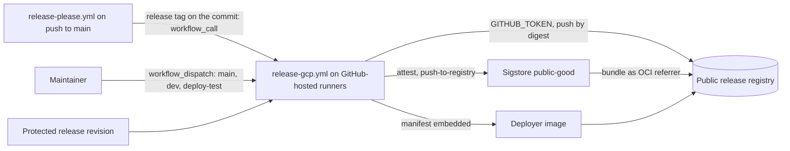
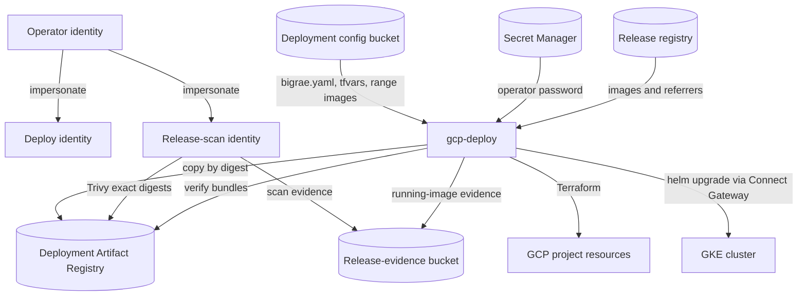
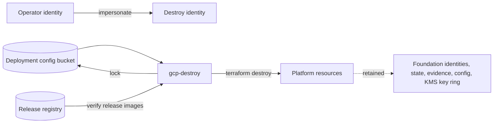
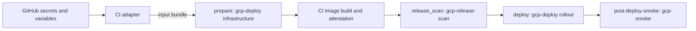
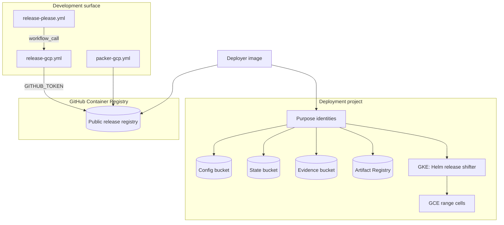
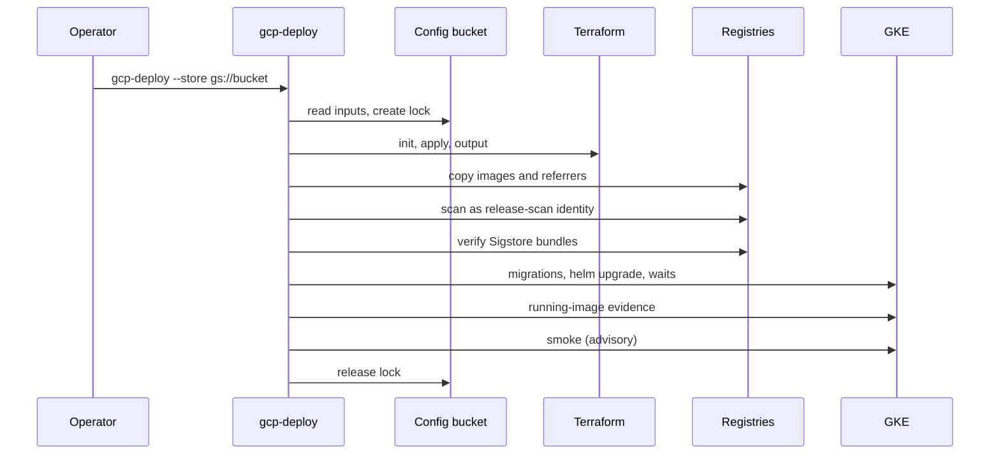

# GitHub-less GCP deployment design (#2571, ADR-070)

Status: implementation design. Date: 2026-10-28.

This design records the decisions for issue #2571. An operator can stand up,
update, and tear down a GCP deployment with no dependency on GitHub. Live
deployment for testing is issue #2572. The AWS counterpart is issue #2573.
[ADR-070](../adr/070-github-less-gcp-deployment.md) records the binding
decision. ADR-003, ADR-004, ADR-007, ADR-033, ADR-037, ADR-053, and ADR-069
receive the rule revisions listed under [ADR changes](#adr-changes).

## Context

Before this change, a GCP deployment depended on GitHub in these ways:

| Dependency | Mechanism before this change |
| --- | --- |
| Update execution | `deploy.yml` called `_gcp-dev.yml`, which held most of the deploy logic as inline shell and Python. |
| Configuration and secrets | Five GitHub Environments per deployment held the root config, project, hostname, operator password, image references, and range settings. |
| Cloud trust | GitHub OIDC tokens federated through Workload Identity Federation (WIF) into purpose service accounts. |
| Execution host | A self-hosted runner per deployment, registered to the repository. |
| Image provenance | `gh attestation verify` read attestations from the GitHub API. |
| Image supply | Every deploy built the five control-plane images from a repository checkout. |
| Deployment definition | A deployment needed committed values, a Kustomize overlay, and workflow choice-list entries. |
| Base guest images | `gcp_base_images.py` pulled from `ghcr.io/<repository owner>` and wrote references to a GitHub Environment. |
| Teardown | `gcp-dev-destroy.yml` ran under a GitHub-federated destroy identity. |

The local `gdc-bootstrap` path did a first install without Actions. It did not
run the release gates of ADR-037, it rendered with the Helm chart while CI used
Kustomize, and it built images on the operator workstation.

## Decision summary

1. A release is built once. A release workflow builds the five control-plane
   images and one deployer image, publishes them to a release Artifact
   Registry repository, and stores SBOM and provenance attestations next to
   each image.
2. One deploy implementation serves the first install and every update. The
   bootstrap CLI (`scripts/bootstrap/deploy.py`) owns it. CI workflows call the
   same commands.
3. Each deployment keeps its inputs in GCP: a deployment config bucket for the
   root config, the Terraform values, and generated references, and Secret
   Manager for secret values.
4. Operators run the commands under service-account impersonation of the
   existing purpose identities. The deployment needs no GitHub OIDC trust and
   no runner.
5. The deploy command runs every ADR-037 gate: an exact-digest vulnerability
   scan under the release-scan identity, provenance verification without
   GitHub, and a closed running-image check after rollout.
6. The Helm chart is the only Kubernetes renderer. The Kustomize tree and its
   overlay-only renderers are removed.
7. A new deployment needs no change to this repository.

## Architecture

### Components

| Component | Location | Responsibility |
| --- | --- | --- |
| Release workflow | `.github/workflows/release-gcp.yml` | Builds, attests, and publishes the five control-plane images and the deployer image for one source revision. Development surface. |
| Release trigger | `.github/workflows/release-please.yml` | Calls the release workflow for each release that Release Please creates on `main` (#2660). |
| Release registry | `ghcr.io/<owner>/<repository>` | Public registry for release artifacts (#2659). The release workflow writes it with the workflow `GITHUB_TOKEN`. Every deployment reads it, or reads an operator mirror of the same digests. |
| Deployer image | `platform/deployer/gcp/Dockerfile` | The bootstrap CLI, the installation package, the GCP scripts, the Terraform roots and modules, a Terraform provider mirror, the Helm chart, the smoke script, and pinned tools. It embeds the release manifest. |
| Release manifest | `/opt/bigrae/release.json` in the deployer image, or a file | Schema `bigrae.gcp-release.v1`: version, source revision, exact image identities, chart version, the guest images (`base_images`, #2679, #2668), and the OpenFGA authorization model. |
| Deployment input bundle | The deployment config bucket (`deployment_config_bucket_name`, for example `gs://<project>-deployment-config/`) or a local directory | `bigrae.yaml`, `terraform.tfvars` or `terraform.tfvars.json` or both, generated `range-images.json`, and optional inputs. |
| Purpose identities | `platform/terraform/gcp/global/cicd-oidc` (`cicd-oidc-identity` module) | Deploy, release-scan, and destroy service accounts, with impersonation grants to named principals, the deployment config bucket, and optional GitHub federation. |
| Deploy commands | `scripts/bootstrap/gcp_deploy.py` and its focused modules | `gcp-deploy`, `gcp-release-scan`, `gcp-smoke`, `gcp-destroy`, and `gcp-config`. |
| Kubernetes renderer | `platform/charts/shifter` | The only GCP renderer, with `values-gcp-<profile>.yaml` and generated values. |
| CI adapter | `scripts/gcp/render_ci_deployment_inputs.py` | Renders GitHub secrets and variables into the same input bundle for CI deploys (`--purpose deploy`) and teardowns (`--purpose destroy`). |

### Release

The release workflow runs only from protected `refs/heads/main`,
`refs/heads/dev`, or `refs/heads/deploy-test`. Two events start it:

- `workflow_call` from the `release-gcp` job of `release-please.yml` (#2660).
  That job runs on a push to `main` only when a release tag points at the pushed
  commit. The `release-commit` step finds the tag from the repository, not from
  the action output, so a re-run of that run publishes the release again. The
  job passes the version and the commit. The run stops when that commit is not
  the commit that it builds.
- `workflow_dispatch` by the maintainer. Use it for test builds from `dev` or
  `deploy-test`, or to publish a release again.

Release Please creates the release with the workflow `GITHUB_TOKEN`. GitHub
starts no workflow run for an event from this token, except
`workflow_dispatch` and `repository_dispatch`. Thus a `release` event trigger
cannot start the release workflow. A called workflow in the same repository
runs from the commit of the caller, with the `github` context of the caller.
Thus the run builds the tagged commit, and `GITHUB_REF` is `refs/heads/main`.

Before it writes `GITHUB_ENV`, the run checks the version and the chart
version against the release manifest patterns. A value with a newline cannot
add an environment variable. A called run must name a full 40-character commit
SHA, and that SHA must be `github.sha`.

Each run has a concurrency group for its commit. GitHub cancels a pending run
when a newer run joins its group. One shared group could thus drop the release
of another commit. Runs for different commits publish different tags and run in
parallel.

The Release Please job has the `release-please` concurrency group. The GCP
release build does not hold that group. GitHub can still replace a pending run
of a release commit. The next run then creates the release of that commit. Its
`release-superseded` job fails and names the run to re-run. A re-run finds the
tag and publishes the release.

A GitHub Release stays when its GCP release fails. To recover, re-run the
Release Please run of the release commit. A dispatch from `main` builds the
current head of `main` instead.

The `gcp-release` Environment admits only the release branches. The first step of the
job rejects every other ref before checkout and the registry login. The job
publishes to the public release registry `ghcr.io/<owner>/<repository>` with
the workflow `GITHUB_TOKEN` and uses no cloud identity (#2659).

The workflow does these steps:

1. Build the portal, provisioner, guacd, guacamole-client, and openvpn images
   on GitHub-hosted runners, with no cache, a BuildKit SBOM, and maximum
   BuildKit provenance. Push each image to the release registry with the
   full source revision as its tag.
2. Sign the build provenance of each digest with
   `actions/attest-build-provenance` and `push-to-registry: true`. The
   attestation is a Sigstore bundle stored as an OCI referrer of the image.
3. Write the release manifest from the five digests.
4. Build the deployer image with the manifest and the source revision
   embedded, and push it.
5. Scan the deployer image digest with the blocking Trivy gate: `trivy image
   --scanners vuln --severity HIGH,CRITICAL --ignore-unfixed --exit-code 1`,
   with the databases from `mirror.gcr.io` and the ignore file
   `platform/deployer/gcp/trivyignore.yaml`. A HIGH or CRITICAL finding with
   a fix stops the release before the attestation.
6. Attest the deployer image the same way as the other images.
7. Write the deployer digest and the manifest to the job summary.

`platform/deployer/gcp/trivyignore.yaml` holds the only accepted deployer
exposures. Each entry is a HIGH finding in a vendor binary that no vendor build
fixes yet: `gcloud-crc32c`, `helm`, `kubectl`, `oras`, and `trivy`. Each entry
expires on 2026-11-30. After that
date, the gate blocks each release until the tools are updated. The file does
not apply to the control-plane image gate.

The repository is public, so the attestations use the Sigstore public-good
instance. A deployment verifies them with the Sigstore trust root, not with the
GitHub API.

### Deployer image

The deployer image is the GitHub-less execution unit. It holds the repository
subset that the commands read and pinned tools: Terraform 1.17.1, Helm
v3.22.1, kubectl v1.34.13, Trivy 0.76.1, ORAS 1.3.6, the Google Cloud CLI
591.0.0, and `gke-gcloud-auth-plugin`. The image builds the plugin from an
exact `kubernetes/cloud-provider-gcp` commit with a pinned Go image, because
the newest Google build uses a Go release with a CRITICAL finding (#2618). A
provider mirror holds the Terraform providers of each root. Docker `FROM` stages are digest-pinned. Each
downloaded tool is verified against a SHA-256 value that the reviewed
Dockerfile pins; the build does not fetch the checksum from the download
origin. Python dependencies install from frozen, hash-pinned exports
(ADR-037-R2, -R3, -R4).

The image sets `BIGRAE_SOURCE_REVISION` and `BIGRAE_RELEASE_MANIFEST`, and it
runs as the non-root user 10001. Its build stops when the manifest names
another revision, when a Terraform root does not initialize from the mirror,
or when the command line does not load.

An operator verifies the deployer image provenance before running it. The
[deployment guide](../technical/handbook/gcp-github-less-deployment.md#get-and-verify-the-deployer-image)
gives a `cosign verify-attestation` command. That command is not yet confirmed
against a real release. In operator mode, every stage of the deploy command
then needs the release manifest. Before any change, it checks that its own
source revision equals the manifest revision, and it verifies the provenance of
the release images.

### Deployment input bundle

| Object | Owner | Content |
| --- | --- | --- |
| `bigrae.yaml` | Operator | Root installation config. Secrets appear only as references. |
| `terraform.tfvars`, `terraform.tfvars.json` | Operator | Platform Terraform values: sizing, network ranges, identity allow-list, and similar inputs. At least one file is required. The JSON file loads later, so its values win. |
| `range-images.json` | `gcp-images` or `gcp-config set-range-image` | GCE image or image-family references for the `linux`, `kali`, `windows`, and `dc` roles. `gcp-images` writes exact image references. |
| `foundation-inputs.json` | Operator, optional | Non-secret foundation inputs for the image-network reconcile. |
| `model-broker-overlay.template.json` | Operator, optional | Reviewed model broker overlay template. The broker is parked (ADR-068). |
| `retired-cluster-artifacts.json` | Operator, optional | Inventory of manual qualification objects to retire. |
| `locks/deploy.lock` | Deploy and destroy commands | Per-deployment lock. |

The cicd-oidc root, which `gcp-foundation` applies, creates the bucket with
uniform access, public access prevention, and versioning. Cloud Audit Logs
(storage `DATA_READ` and `DATA_WRITE`) record each read and write. Usage-log
delivery to the release-evidence bucket under the `deployment-config-access`
prefix is optional (`enable_gcs_usage_log_delivery`), because a Domain
Restricted Sharing org policy rejects its Google-managed writer group (#2585).
The deploy and destroy identities read the bucket and manage only `locks/`.
The principals that may impersonate the deploy identity can write it. The
principals that may impersonate only the destroy identity can read it.

### Input homes

Every input that the GCP deploy and destroy read from GitHub before this change
has one home outside GitHub.

| Former GitHub input | New home |
| --- | --- |
| `GCP_PROJECT_ID` | `settings.project_id` |
| `GCP_REGION` | `settings.region` |
| `GCP_PUBLIC_HOSTNAME` | `deployment.domain` |
| `SHIFTER_CONFIG_GCP_DEV` | `bigrae.yaml` |
| `SHIFTER_CONFIG_OVERLAY_JSON` | `model-broker-overlay.template.json` |
| `GCP_IDENTITY_ALLOWED_EMAIL_DOMAIN` | Terraform value `identity_allowed_email_domain` |
| `GCP_MASTER_AUTHORIZED_CIDRS` | Not read. The operator sets the Terraform value `gke_master_authorized_cidrs`. The CI adapter sets `[]`. |
| `GCP_BOOTSTRAP_ADMIN_EMAIL` | `settings.operator_bootstrap.admin_email` |
| `GCP_BOOTSTRAP_ADMIN_PASSWORD` | Secret Manager, through `settings.operator_bootstrap.admin_password_secret_ref`. CI passes the value with `--operator-password-env`. |
| `SHIFTER_SKIP_OPERATOR_BOOTSTRAP` | `settings.operator_bootstrap.enabled` |
| `PLATFORM_BOOTSTRAP_STAFF_EMAILS` | `settings.operator_bootstrap.staff_emails` |
| `PLATFORM_BOOTSTRAP_SUPERUSER_EMAILS` | `settings.operator_bootstrap.superuser_emails` |
| `SMOKE_TEST_USER_EMAIL` | `settings.post_deploy_smoke.user_email` |
| `GCP_CTF_CONTENT_BUCKET` | `settings.ctf_content_bucket` |
| `RANGE_OPENVPN_ENABLED` | `settings.participant_openvpn.enabled` |
| `GCP_RANGE_BACKEND` | `settings.range_cells.backend` |
| `RANGE_NETWORK_ZONE` | `settings.range_cells.zone` |
| `RANGE_NETWORK_ZONES` | `settings.range_cells.zones` |
| `GCP_RANGE_CELL_PROJECT_ID` | `settings.range_cells.project_id` |
| `GCP_RANGE_HOST_IDENTITY_POOL_SIZE` | `settings.range_cells.host_identity_pool_size` |
| `GCP_RANGE_PRIVATE_GOOGLE_ACCESS` | `settings.range_cells.private_google_access` |
| `GCP_RANGE_IMAGE_KEY_PROFILES_JSON` | `settings.range_cells.image_key_profiles` |
| `GCP_RANGE_LINUX_IMAGE`, `GCP_RANGE_KALI_IMAGE`, `GCP_RANGE_WINDOWS_IMAGE`, `GCP_RANGE_DC_IMAGE` | `range-images.json` |
| `GCP_RANGE_HOST_SERVICE_ACCOUNT_EMAIL` | Terraform output `range_host_service_account_email` |
| `GCP_FOUNDATION_INPUTS_JSON` | `foundation-inputs.json` |
| `GCP_DEPLOY_SERVICE_ACCOUNT`, `GCP_RELEASE_SCAN_SERVICE_ACCOUNT`, `GCP_DESTROY_SERVICE_ACCOUNT` | Derived from the `shifter-<environment>` naming contract, with command overrides |
| `GCP_WORKLOAD_IDENTITY_PROVIDER` | Not used without GitHub |

`settings.release_trust` holds the immutable repository and owner IDs that
sign releases. It is the provenance trust anchor (ADR-069-R3).

### Commands and stages

`gcp-deploy` runs these stages in order. CI runs the same stages in separate
jobs. `--stage infrastructure` and `--stage rollout` run one stage. An operator
rollout (`--stage rollout` without `--identity ambient`) also imports and scans
the release images, so no operator stage skips the scan gate. CI scans in its
separate release-scan job, which the rollout job needs.

| Stage | Identity | Steps |
| --- | --- | --- |
| Inputs | Operator for the bundle and the base images, or the deploy identity when `--deploy-service-account` is set; deploy for the lock | Check the required tools, load and validate the bundle, load the release manifest, check the tooling revision (operator mode), resolve the trust anchor, import the release's pinned base range images when the bundle has none (operator mode), and take the deployment lock. |
| Infrastructure | Deploy | Read the operator password, initialize Identity Platform, optionally reconcile the foundation image network, apply the broker overlay of an existing cluster, create and harden the state bucket, ensure the Artifact Registry service identity, render the Terraform inputs, initialize Terraform, import the Identity Platform config, release a disabled broker load balancer, apply Terraform, read the outputs, verify range audit telemetry, create an isolated kubeconfig, and seed the bootstrap operator. |
| Images | Deploy | Check the GCE range preconditions. Copy each release image and its referrers by digest into the deployment Artifact Registry. CI-built images are already there. |
| Scan | Release scan | Scan each exact digest with the pinned Trivy for fixed HIGH and CRITICAL findings, with the repository ignore file. Write raw evidence and the redacted verdict to the release-evidence bucket, and stop on a finding. Only the full deploy runs this stage; CI runs `gcp-release-scan`. |
| Provenance | Deploy | Verify the provenance of each image against the trust anchor and the manifest revision. |
| Rollout | Deploy | Read the broker overlay, ensure the OpenVPN PKI, render the runtime environment and the Helm values, create the namespaces, generate the OpenFGA credentials on first use, adopt existing objects, run migrations, publish the release's authorization model and render again with its IDs, sync the Guacamole secret and the policy credentials, run `helm upgrade --install --atomic`, retire inventoried artifacts, remove retired objects, restart workloads, wait for rollouts and superseded pods, roll out the OpenVPN pool, record running-image evidence, and wait for the ingress address and the managed certificate. |
| Smoke | Deploy | Run the post-deploy range smoke. An empty `settings.post_deploy_smoke.user_email` or `--no-smoke` skips it. It is advisory: a failure returns exit status 3 after the deployment completes. |

`gcp-release-scan` runs the scan stage alone. `gcp-smoke` runs the smoke stage
alone. `gcp-destroy` runs the teardown. `gcp-config` publishes, pulls, and
shows the bundle and sets range image references. `gcp-install` applies the
foundation from the bundle and the operator's identity, creates the initial
operator password secret, publishes the bundle, and runs the first install
(#2679). On an empty database, the first install writes the identity facts
from the configured operator account, and the catalog Job registers the in-box
catalog as the recorded bootstrap administrator.

### Identity

Without GitHub, an operator authenticates with their own Google identity. The
commands set impersonation for the subprocesses of each stage:

- `CLOUDSDK_AUTH_IMPERSONATE_SERVICE_ACCOUNT` for `gcloud`,
  `gke-gcloud-auth-plugin`, and the Docker credential helper;
- `GOOGLE_IMPERSONATE_SERVICE_ACCOUNT` for the Terraform Google provider;
- `GOOGLE_BACKEND_IMPERSONATE_SERVICE_ACCOUNT` for the Terraform `gcs` backend.

Each stage uses only its purpose identity. The scan stage never runs as the
deploy identity, so evidence producers stay separate (ADR-004-R23). The
command reads the bundle as the operator, or as the deploy identity when
`--deploy-service-account` is set. CI uses `--identity ambient`, because WIF
already supplies the purpose identity of each job.

The `cicd-oidc-identity` module grants
`roles/iam.serviceAccountTokenCreator` on each purpose identity only to the
principals in `impersonation_principals`. GitHub federation is optional. The
module creates the WIF pool and provider only when `purpose_contexts` is not
empty, and the GitHub repository and owner IDs are then mandatory. No release
identity exists: the release workflow publishes to the public registry with
the workflow token (#2659).

### Provenance verification

For each image digest, a minimal OCI distribution client (`gcp_oci.py`) lists
the Sigstore bundle referrers through the referrers API or its tag fallback. It
fetches the bundles with digest checks from the image registry only. It sends
the Google access token only to an Artifact Registry host. For any other
registry, such as the public release registry, it uses the anonymous bearer
token flow of the distribution specification. The command verifies them with sigstore-python against the public-good trust root.
The policy requires all of these:

- the GitHub Actions OIDC issuer;
- the source repository ID and owner ID from `settings.release_trust`;
- the source revision digest equal to the release manifest revision.

The in-toto statement must name the exact image digest as its subject and use
the SLSA provenance v1 predicate. Any failure stops the deploy. There is no
bypass mode (ADR-037-R6).

### Mirror

A deployment that cannot reach the public release registry uses a mirror. The
operator copies each release image by digest, with its referrers, to
`<mirror>/<image name>`. Then the operator passes `--release-source <mirror>`
to `gcp-deploy`, `gcp-destroy`, or `gcp-release-scan`. The commands verify,
scan, and import `<mirror>/<image name>@<release digest>`. The provenance
policy binds the digest, so a mirror cannot change the release (ADR-070-R9).

### Lock

The command creates `locks/deploy.lock` in the deployment config bucket with
the precondition `--if-generation-match=0`. It deletes the lock at the end
with a generation precondition. A held lock fails the command and names the
holding command, its run ID, and its start time. `--break-lock` removes the
lock with no prompt before the command takes it. Use it only for a stale lock.
CI uses `--lock external`, because the workflow concurrency group already
queues deploys per deployment.

### Renderer

The Helm chart renders every workload, Service, NetworkPolicy, RBAC object,
admission policy, ingress, and certificate. The command creates the
`shifter-platform` and `shifter-jobs` namespaces outside the release, as the
bootstrap did before.

A deployment that CI deployed with Kustomize moves to Helm without deletion.
Before the upgrade, the command renders the chart. For each rendered object
that exists without Helm ownership, it adds the `app.kubernetes.io/managed-by:
Helm` label and the `meta.helm.sh/release-name` and
`meta.helm.sh/release-namespace` annotations (Helm 3.2 adoption). An object
that another Helm release owns stops the command. After a successful upgrade,
it removes the Kustomize-only objects in a closed list: the two
`*-google-apis-egress` policies and the empty `platform-runtime-secrets`
Secret. The chart's provider-API egress policies allow the same Google API
ranges. The chart renders the two portal and guacamole-client policies with
their Kustomize names, so the command adopts them.

### Teardown

`gcp-destroy` runs as the destroy identity. It requires `--confirm
<environment>`, takes the deployment lock, renders the same Terraform inputs
as the deploy, lifts Cloud SQL deletion protection, removes the unremovable KMS
key ring and key from state, and runs `terraform destroy` with bounded retries.
The protected-branch check of the workflow becomes a tooling check. In operator
mode, the command loads the release manifest and verifies the release images
against the trust anchor. It runs only from tooling whose source revision
equals that revision: the deployer image or a clean checkout.

### Base guest images

Issues #2679 and #2668 changed this section. A developer build of
`packer-gcp.yml` publishes each validated guest image to the release registry
as `gce-<role>`, with signed build provenance. Each release names the newest
verified publication of each role in its manifest. `gcp-deploy` imports those
images as the operator when the bundle has none, and `gcp-images` imports them
on request. Both verify the digest, the OCI contract, and the provenance of
every role before any change, and both reuse unchanged images. The imported
references go to `range-images.json` in the input bundle. See
[GCP Guest Images](gcp-guest-images.md).

### CI

`_gcp-dev.yml` keeps its jobs and Environments. The `prepare`, `deploy`, and
`post-deploy-smoke` jobs render the input bundle from GitHub secrets and
variables with the CI adapter. Each job calls the commands:

| Job | Command |
| --- | --- |
| `prepare` | `gcp-deploy --stage infrastructure --image-roots-output`, then the image build and attestation |
| `release_scan` | The release manifest of the CI images, then `gcp-release-scan` |
| `deploy` | `gcp-deploy --stage rollout`, with the trust anchor from the workflow context |
| `post-deploy-smoke` | `gcp-smoke`, then the failure issue (CI only). The CI smoke requires `SMOKE_TEST_USER_EMAIL`. |

No GitHub workflow calls `gcp-destroy` after #2668, and no tenant uses the CI
path (#2672 decides its future). CI builds push their attestations to the registry, so the
rollout verifies CI-built and release images the same way. The CI jobs pin
Terraform 1.17.1, Helm v3.22.1, and Trivy 0.76.1, the same versions as the
deployer image. The `gcp-deployer-image` job of `_quality.yml` builds the
deployer image, starts it, and runs the same blocking scan as the release
workflow.

## Systems security engineering

| Asset | Threat | Control | Verification |
| --- | --- | --- | --- |
| Runtime images | A deploy runs an image that the trusted repository did not build | Sigstore verification bound to the immutable repository IDs and the manifest revision, with no bypass | Unit tests check that the policy binds the issuer, both IDs, and the revision. They reject a wrong subject digest or predicate type and fail closed without a satisfying bundle |
| Runtime images | A deploy runs an image with a known HIGH or CRITICAL finding | The exact-digest Trivy gate under the release-scan identity blocks the rollout in every operator run and in CI | Unit tests prove that a finding stops the command before rollout |
| Release evidence | One identity forges another identity's evidence | Separate scan and deploy identities with prefix-scoped evidence grants | The scan stage environment names only the scan identity; Terraform conditions keep the prefixes |
| Deploy identity | An unauthorized person deploys | `roles/iam.serviceAccountTokenCreator` only for named principals; no keys | Native Terraform tests check the bindings; no key resource exists |
| Deployment inputs | Secret values leak through files, argv, logs, or Helm history | References in config; values from Secret Manager into environment variables and 0600 temporary files; Guacamole secret outside Helm | Tests check file modes, argv, and that values never reach Helm values |
| Deployment state | Two deploys race on Terraform state or the cluster | GCS lock with generation preconditions, or the CI concurrency group | Unit tests cover create, conflict, release, and break |
| Release workflow | An unreviewed ref, an unreviewed caller, or a mismatched commit starts a publishing run | Only `workflow_dispatch` and `workflow_call` start the workflow. Only the `release-gcp` job of `release-please.yml` calls it, after a release on `main`, with no inherited secrets. The ref check and the `gcp-release` Environment admit only the release branches. A called run stops when the tagged commit is empty or is not the built commit | The `release-workflow-provenance` check (ADR-004-R23) reads both workflows. Its unit tests reject other triggers, other callers, an ungated or secret-inheriting call, changed output wiring, and other `release-please.yml` events |
| Release workflow | A crafted version adds a variable to `GITHUB_ENV` | The run checks the version and chart version against the manifest patterns before it writes `GITHUB_ENV` | Workflow review; the manifest model rejects the same values again |
| Deployer image | A release ships deploy tooling with a known HIGH or CRITICAL finding | The release workflow scans the deployer image digest with the blocking Trivy gate before it attests the image. Time-boxed entries in `platform/deployer/gcp/trivyignore.yaml` (expiry 2026-11-30) are the only accepted exposures | The `release-workflow-provenance` check (ADR-070-R1) requires the scan step before the attestation. The quality workflow runs the same scan |
| Deploy tooling | Modified tooling runs with deploy authority | Revision check and release provenance check before any change in every operator stage; operator verifies the deployer image | Tests reject a mismatched or unclean revision |
| Cluster objects | The Helm move deletes or orphans live objects | Adoption by ownership metadata before upgrade; closed retired-object list after a successful upgrade | Tests cover adoption selection and the retired-object list |
| Operator kubeconfig | The deploy overwrites the operator context | An isolated temporary `KUBECONFIG` per run, with Connect Gateway credentials | Tests check the isolated kubeconfig and that the deploy never uses direct endpoint credentials |

Trust boundaries:

1. The release workflow runs in GitHub Actions. It is the development surface.
2. The release registry is the boundary between release and deployment.
3. The operator workstation or deployer container holds the operator identity.
4. The deployment project holds the purpose identities, the state, the
   evidence, the config, and the platform.
5. The GKE cluster is reached only through Connect Gateway.

## Data flow

### Release publication

### First install and update

### Teardown

### CI deploy

## Diagrams

### Component view

### Deploy sequence

## Policy as code

- Workflow tests (`scripts/adr_guard/tests/test_deploy_workflow.py`) check
  that the mutating jobs bind their Environments, and that the input bundle stays
  outside the checkout. They also check that the operator password never
  reaches argv.
- The `release-workflow-provenance` adr-guard check reads `release-gcp.yml`:
  `workflow_dispatch` and `workflow_call` only, a single caller (the gated
  `release-gcp` job of `release-please.yml` on a push to `main`, with no
  inherited secrets), the `gcp-release` Environment, GitHub-hosted
  runners, the ref check before authentication, pinned actions, and an SBOM,
  maximum provenance, and a `push-to-registry: true` attestation for each
  build. It also requires the blocking scan of the deployer image digest
  before the deployer attestation (ADR-070-R1).
- The GCP WIF trust guard (`scripts/check_tf_gcp_wif_trust`) covers the
  optional provider and the impersonation bindings.
- Kubernetes security checks read the rendered Helm chart instead of the
  Kustomize base. The Checkov exceptions CKV_K8S_35 (guacamole-client) and
  CKV_K8S_38 (provisioner launcher) sit on the chart Deployments.
- The quality workflow checks the deployer Dockerfile with `docker build
  --check` and `trivy config`. It builds the deployer image with a fixture
  manifest, starts it, and scans it with the blocking Trivy gate.
- Bootstrap unit tests cover every gate: scan blocking, provenance policy,
  running-image check, lock, tooling revision, secret handling, adoption, and
  retired objects.

## Architecture as code

| Artifact | Change |
| --- | --- |
| `platform/terraform/gcp/modules/cicd-oidc-identity` | Optional GitHub federation, impersonation grants, the deployment config bucket and its IAM |
| `platform/terraform/gcp/global/cicd-oidc` | New inputs, outputs, and native tests |
| `platform/charts/shifter` | Sole GCP renderer |
| `platform/k8s/gcp` | Removed |
| `platform/deployer/gcp` | New deployer image |
| `platform/terraform/validation-inventory.yaml` | Registers the new root |

## ADR changes

| ADR | Change |
| --- | --- |
| ADR-070 (new) | GitHub-less GCP deployment from published releases |
| ADR-037 decision, R5, R6, R8 | Attestations stored with the image; verification without GitHub, bound to the deployment trust anchor; the gates run in the deploy command |
| ADR-004-R23 | Impersonation-only purpose identities; optional federation. #2660: Release Please calls the release workflow for each release on `main` |
| ADR-042-R2 | #2660: a release on `main` publishes the GCP release through the release workflow, with no cloud identity |
| ADR-069-R3 | The repository IDs are mandatory when federation exists; `settings.release_trust` is the provenance anchor |
| ADR-033-R2, ADR-053-R3 | The product deployment model is the release-driven bootstrap CLI |
| ADR-007-R1, R2 | The Helm chart is the only GCP renderer; first install and update share one entrypoint |
| ADR-003-R6 | The GCP smoke runs through `gcp-smoke`; the CI job keeps the failure issue |

## Migration of existing deployments

Existing CI deployments keep their workflows, Environments, and committed
Terraform values. Their first deploy after this change uses the Helm renderer
and adopts the Kustomize-applied objects. Their root config must name the same
project and hostname as their GitHub secrets, because the CI adapter rejects a
conflicting value. To move a deployment off GitHub, the operator runs the
GitHub-less foundation mode, publishes the input bundle, and then deploys with
the deployer image. The [deployment guide](../technical/handbook/gcp-github-less-deployment.md)
lists the steps.

## Document review

Review checks STE sentence length, one word for one meaning, and that every
statement matches the code. The updated documents are listed in issue #2571
and in the pull request.
