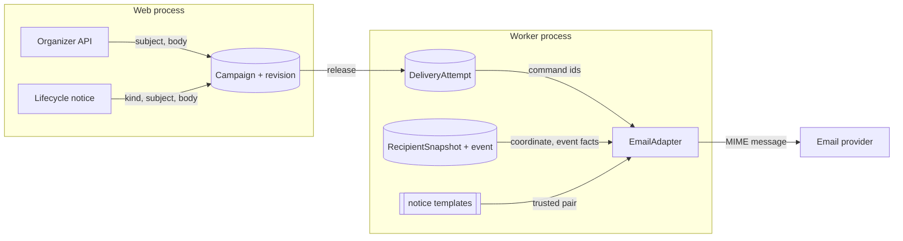

# Communication ledger email templates (#580)

Status: accepted design, 2026-10-30. Requirement: CTF-805. This note
specializes ADR-051-R9, ADR-051-R14, and ADR-071.

## Decision

The maintainer chose to remove the per-event override API (#580, criterion 2).
Ledger email uses one trusted default template pair for each notice kind.

- `CommunicationCampaign.notice_kind` records the kind. The value is closed and
  immutable.
- The email adapter selects `ctf/email/notice/<kind>.html` and `.txt`.
- The `CTFEmailTemplate` model, API, admin, serializers, and policies are
  removed. A migration drops the table and its rows.
- The dead `_render_email` function, `ctf.services.email_template`, and the
  legacy `ctf/email/*` default pairs are removed.

### Reasons for removal

- Stored overrides contain organizer HTML. Placeholder validation does not
  sanitize HTML. The ledger content profile escapes authored content and never
  renders it as HTML.
- No live sender reads the overrides. The SPA has no template editor.
- CTF-805 makes per-event customization optional.

## Architecture

| Component | Responsibility |
| --- | --- |
| `ctf.enums_communication.NoticeKind` | Closed kind set: `announcement`, `reminder`, `cleanup`, `results`, `range_ready`, `range_failure`. |
| `CommunicationCampaign.notice_kind` | Stores the kind. A database check constraint admits only the closed set. Model validation refuses a change after creation. Existing rows get `announcement`. |
| `campaigns.create_campaign` | Organizer authoring. Accepts only `announcement`. |
| `campaigns.create_system_event_campaign` | Trusted lifecycle notices. Accepts any closed kind. |
| `notification.ledger.stage_notice` | Passes the server-selected kind into the draft. |
| `adapters.email.EmailAdapter` | Selects the pair for the kind. Builds a scalar context. Renders through `shared.email.render_template()`. Sends through `attempt_email()`. |
| `templates/ctf/email/notice/` | Trusted default pairs, one pair for each kind, packaged in the image. |

The adapter context contains only scalar strings:

| Name | Source |
| --- | --- |
| `subject`, `body`, `locale` | Pinned `MessageRevision`. |
| `participant_name` | Live participant of the snapshot. Empty after removal. |
| `event_name` | Event of the snapshot. |
| `event_start`, `event_end`, `event_timezone` | Event of the snapshot, in the event timezone. |
| `recipient_start`, `recipient_offset`, `recipient_timezone` | Event start in the participant time zone, else the event time zone, else UTC ([#582](ctf-recipient-time-zone-582.md)). |
| `event_url` | `validated_site_url()` and the `ctf:participant_event` route. |

The adapter uses the snapshot event, not the first campaign event. Each
recipient sees the facts of the event that qualifies that recipient.

Retries render again from the same kind and the same pinned revision. The event
facts are current at each attempt. A retry shows a corrected event date or name.
No organizer content enters the wrapper, so no presentation freeze is necessary.

### Failure behavior

| Condition | Outcome | Reason |
| --- | --- | --- |
| `SITE_URL` is not a safe origin | Retriable | `site_url_unavailable` |
| Kind outside the closed set | Not possible | The check constraint rejects the row. |
| Snapshot or coordinate missing | Terminal | Unchanged (ADR-071). |

## Systems security engineering

| Asset | Threat | Control | Verification |
| --- | --- | --- | --- |
| Participant mail client | Script or tracking markup in mail (CWE-79) | Django autoescape on every value. No organizer HTML source exists. The body stays escaped Markdown source. | Adapter test with hostile subject, body, and event name. |
| Server templates | Template injection (CWE-1336) | Only server files under `ctf/email/notice/` render. The kind selects a path from a closed map, never from input. | Unit test that every kind has a pair. Constraint test. |
| Event portal link | Host header poisoning | The URL comes from `SITE_URL` through `validated_site_url()`, never from a request. | Adapter test with an unsafe `SITE_URL`. |
| Recipient coordinate | Disclosure | Unchanged: the adapter decrypts only its own snapshot coordinate. | Existing adapter tests. |
| Authoring authority | Organizer forges a system kind | `create_campaign` refuses kinds other than `announcement`. The public API has no kind field. | Service test. |
| Stored override rows | Stale unsafe HTML | The migration drops the table. | Migration test. |

Residual risk: the drop migration deletes organizer override rows. Delivery
never used those rows, so no delivered email changes.

## Data flows

Trust boundaries: the organizer API boundary, the database boundary, and the
provider boundary. Only the worker crosses the provider boundary.

## Policy and architecture as code

- ADR-051-R9 changes: `CTFEmailTemplate` is retired, and kind-selected default
  pairs are the email presentation.
- `openapi/v1.retirements.json` records the retired
  `/api/v1/ctf/events/{event_id}/email-templates/{notification_type}/` path under
  ADR-051, issue 580.
- `tests/contracts/identity_authorization_surfaces.json` and
  `ctf/api/operation_policy.py` drop the retired operations.
- Import boundaries do not change. `shared.email` does not import CTF code.
- No setting, secret, service, or deployment change is necessary.

## Non-goals

Template editor, organizer customization, new template language, organizer
recipients, credential email, and a second outbox.
