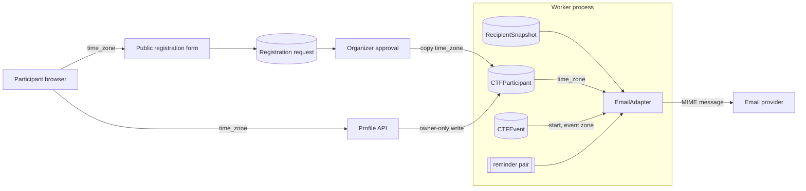

# Reminder content in the recipient time zone (#582)

Status: accepted design, 2026-10-31. This note specializes ADR-051-R14 and
ADR-071. It extends [#580](ctf-ledger-email-template-boundaries-580.md).
[The preflight note](ctf-reminder-content-preflight-582.md) gives the boundaries.

## Decisions

The maintainer made these decisions on 2026-10-31:

- Add an optional time zone to the participant. Capture it at public
  registration from the browser zone. The reminder email shows the start time
  in that zone. When the zone is unknown, the email uses the event zone.
- The model default for `CTFEvent.reminder_hours` becomes `[24, 1]`. A data
  migration sets `[24, 1]` on events that have `[]` stored and have not
  started. After that, `[]` disables reminders.

## Existing coverage

Ledger email delivery exists (#1525). The reminder pair already shows the event
name, the start time, and the portal URL (#580). The start time uses the event
zone. No model stores a recipient zone.

## Architecture

| Component | Change |
| --- | --- |
| `shared.time_zones` | New. `is_valid_time_zone()` accepts only names in `zoneinfo.available_timezones()`. `time_zone_choices()` returns the sorted names. Both cache the set. |
| `CTFParticipant.time_zone` | New optional IANA name. Blank means unknown. |
| `CTFPublicRegistrationRequest.time_zone` | New optional IANA name from the public form. Approval copies it to the participant. |
| `PublicRegistrationForm.time_zone` | New optional choice field. A static script preselects the browser zone. The form works without the script. |
| `participant.profile.update_own_profile` | Accepts `time_zone`. `None` keeps the value. Blank clears it. A name that is not valid is refused. |
| Profile API, projection, `AccountPage` | Read and write `time_zone`. The page suggests the browser zone. |
| `event._validation.validate_event_timezone` | New. Event create and update refuse a name that is not valid. Blank stays permitted. |
| `event.scheduling` | Uses `reminder_hours` as stored. Removes duplicates. Ignores booleans. An event update that changes `reminder_hours` during registration replaces the pending reminders. |
| `adapters.email._recipient_facts` | Adds `recipient_start`, `recipient_offset`, and `recipient_timezone`. |
| `notice/reminder` pair | Shows `recipient_start`, `recipient_offset`, and `recipient_timezone`. |

The event fields `event_start`, `event_end`, and `event_timezone` keep the
meaning that #580 gives them. Other notice kinds do not change. A later notice
kind can use the recipient fields without a change to the adapter.

The adapter selects the display zone in this order:

1. The participant zone, when it is a valid name.
2. The event zone, when it is a valid name.
3. UTC.

The email always shows the zone name and the UTC offset. Thus a reader can see
which zone the time uses. The event zone does not identify the recipient zone.

Each attempt reads the live participant zone and the live event facts. A retry
after a profile change shows the new zone. The pinned revision, the coordinate,
and the Message-ID do not change.

### Failure behavior

| Condition | Outcome |
| --- | --- |
| Participant zone blank or not valid | The event zone is used. |
| Event zone blank or not valid | UTC is used. |
| Profile write with a zone that is not valid | HTTP 400. The value does not change. |
| Public form with a zone that is not valid | HTTP 400 with a field error. No request is stored. |
| Event write with a zone that is not valid | HTTP 400 `CTF_INVALID_TIMEZONE`. |

## Systems security engineering

| Asset | Threat | Control | Verification |
| --- | --- | --- | --- |
| Participant profile | Another actor changes the zone | The existing owner-only locked write and participant permissions. | Profile API test. |
| Zone input | A path or a crafted name loads an unexpected file (CWE-22) | Only names in `available_timezones()` pass. `ZoneInfo` gets no other value. | Validator test with a path name. |
| Public intake | Oversized or crafted values | The choice field accepts only the closed set. The body limit stays 4096 bytes. | Public registration test. |
| Participant mail client | Markup in mail (CWE-79) | Autoescape on every value. The zone is from the closed set. | Adapter test. |
| Logs | Disclosure of recipient data | Logs contain no zone input, name, or address. | Review. |

Residual risk: a participant can select a wrong zone. The email shows the zone
name and offset, so the participant can see the error.

## Data flows

Trust boundaries: the public internet boundary, the participant API boundary,
the database boundary, and the provider boundary.

## Policy and architecture as code

- The profile operation is the same operation. `ctf/api/operation_policy.py`
  and `tests/contracts/identity_authorization_surfaces.json` do not change.
- `openapi/v1.json` and `frontend/src/api/schema.d.ts` are generated again.
- `docs/adr/index.yaml` lists this note under ADR-051.
- Import boundaries do not change. `shared.time_zones` imports no domain code.
- No setting, secret, or deployment change is necessary. The image has the
  IANA data.

## Non-goals

A platform-wide preference, locale or translation, calendar attachments, a
change to scheduling or retries, and catch-up after email becomes available.
