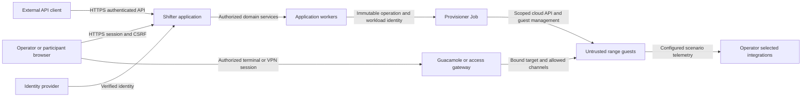

# Current-state architecture handbook

Shifter runs authorized cyber-range exercises through one application control
plane and separately isolated guest workloads. Start here for the current
architecture; subsystem guides provide detail.

**Owner:** [Brad Edwards](https://github.com/Brad-Edwards), assigned through
[CODEOWNERS](https://github.com/Brad-Edwards/shifter/blob/dev/.github/CODEOWNERS).
**Reviewed:** 2026-10-17 against integration revision `6b1c88082`.
This describes source behavior, not a certificate of a live deployment.

## System context and trust boundaries



The browser and external clients request effects; they never own lifecycle
truth. Authentication, current credential permissions, application policy,
resource ownership and tenant ancestry are separate checks. Provider identity
claims and UI selections cannot establish a resource's owner or tenant.
Cloud IAM grants workload/provider authority, independently of application roles.

`management` owns human/service identity; `workspaces` owns customer ancestry
and membership. CMS owns content and desired lifecycle; Engine owns realized
resources and operation state. CTF adds event and participant authority through
CMS services. Event membership, organization/workspace membership, range
ownership, application administration and cloud administration remain distinct.

[ADR-066](../adr/066-account-principal-resource-scope.md) defines Accounts,
independent Principals and explicit ResourceScope. Its S1–S7 adapters are staged;
S8 is the coordinated runtime cutover. Current human entry points retain their
incumbent authority until activation; principal-owned entry points require live
credentials. Do not infer multi-customer isolation or S8 activation from prepared
code. [Content/range authority](shifter_platform/content-range-authority.md) and
[account administration](shifter_platform/account-administration.md) explain the
implemented slices. ADR-054's dedicated-customer model is superseded by ADR-066;
it is not the current target for all installations.

## Deployables and cloud boundaries

| Process or workload | Owner and responsibility |
| --- | --- |
| Django ASGI web and React SPA | `config` composes HTTP/WebSocket routes; domain APIs and Mission Control serve the application from one origin. |
| Domain workers | CMS, Engine and Mission Control consume cloud subscriptions and update their own projections. |
| Schedulers and reconcilers | CTF scheduling, leases, launch delivery, result application and event-outbox delivery run as separate worker commands. |
| Provisioner Jobs | Independently packaged `shifter/engine/provisioner`; exact image, service account and namespace binding; provider effects and guest readback. |
| Plugin/preparation Jobs | Explicitly installed, isolated executable images; separate administrator grants and pinned worker/verifier identities. |
| Guacamole and guacd | Remote-access services; Shifter authorizes the exact target/session and continuing access. Guacamole has separate database credentials. |
| Optional access services | Deployment-selected VPN and other integrations have their own identities and support conditions. |

The canonical control-plane package is the shared Helm chart, hosted on GKE for
GCP or EKS for AWS. Provisioner Jobs use the selected cluster; CI runner placement
is a separate concern. Older ECS files do not define the current AWS package.
GCP bootstrap and CI consume generated configuration from Terraform and Secret
Manager; keep platform hosting separate from the range guest backend.

| Boundary | GCP | AWS |
| --- | --- | --- |
| Control-plane compute | GKE | EKS |
| Participant guest compute | GCE range cells | EC2 ranges |
| Durable database | Cloud SQL PostgreSQL | RDS PostgreSQL |
| Cache and channels | Memorystore Redis | ElastiCache Redis |
| Event transport | Pub/Sub topic/subscriptions | SNS/SQS |
| Artifacts and secrets | GCS / Secret Manager | S3 / Secrets Manager and SSM |
| Human provider authentication | Identity Platform | Cognito/OIDC |

GCP shared-VPC range cells use per-range subnet/tag firewall policy and explicit
NAT membership. Guests have no external NIC. Any attached identity is
participant-visible and must have no management or cross-range authority;
keyless, predict-only model access follows ADR-064. GDC VM Runtime and scenario
Pods are operator validation paths, not participant containment boundaries.
See [GCP deployment](../dev/gcp-range-cell-deploy.md) for exact supported modes
and image prerequisites. GCE does not support the NGFW range capability.

ADR-056 defines provider-enforced guest containment. ADR-057 separates GKE
Dataplane V2 NetworkPolicy reachability, Google Workload Identity, Job admission,
and application authorization. These controls do not provide authenticated
pod-to-pod mTLS; a service mesh remains unadopted. No documentation or unit-test
result proves complete escape detection or live containment qualification.

The model-access broker is **parked and unsupported** under
[ADR-068](../adr/068-model-access-broker-parked.md). Keep broker/model-access
settings disabled. Keyless-direct is the supported guest model path; a proposed
gateway does not provide current budget enforcement or proxy guarantees.

## Commands, results and events

```mermaid
sequenceDiagram
    participant C as Browser or API client
    participant M as CMS service
    participant E as Engine
    participant DB as PostgreSQL
    participant P as Provisioner Job
    participant Q as Event transport
    participant W as Domain workers
    C->>M: Authorized launch or lifecycle command
    M->>E: Validated immutable intent through public facade
    E->>DB: Reserve generation, OperationInput and launch intent
    E->>P: Dispatch pinned command for operation UUID
    P->>DB: Read exact input; append bounded result
    E->>DB: Validate result and atomically apply state, audit, outbox
    E->>Q: Drain committed outbox
    Q->>W: At-least-once event delivery
    W-->>C: Authorized HTTP projections and advisory WebSocket updates
```

This is the authoritative path for the declared RAES, pause/resume and NGFW
operation families. `shared.operation_results` declares supported step contracts;
`engine.services._operation_apply` fences versions, ownership, generation,
digests and legal ordering. Undeclared compatibility families remain
validation-only shadow results while their incumbent writer is retained; do not
assume all direct provisioner SQL is gone.

A launch acknowledgment, queue delivery or successful cloud command is not
READY. Required guest verification and accepted Engine results establish
realized state. Retry identity recovers an existing operation; it never creates
a client-owned generation. Destroyed status alone is not verified absence:
cleanup readback, residual obligations and retained recovery records matter.
See [retry-safe operations](shifter_platform/retry-safe-range-operations.md).

[Range-event delivery](https://github.com/Brad-Edwards/shifter/blob/dev/docs/architecture/range-event-delivery-preflight-476.md)
is an implementation record. The current input/result definitions are
[Engine operation models](https://github.com/Brad-Edwards/shifter/blob/dev/shifter/shifter_platform/engine/models/_operation_io.py),
with shared [wire envelopes](https://github.com/Brad-Edwards/shifter/blob/dev/shifter/shifter_platform/shared/operation_envelope.py).
Reconciliation, bounded retries and dead-letter handling repair delivery;
WebSocket notifications are projections and can be recovered by an authorized read.

## Data ownership and recovery

| Store | Authority, access and recovery owner |
| --- | --- |
| Application PostgreSQL | Domain-owned business rows; Engine immutable inputs, append-only results and outbox; `shared.audit` owns durable audit. Domain services/migrations own writes and grants; operators own backups/restores. |
| Guacamole PostgreSQL | Remote-access service data, independently credentialed; restore must agree with application/access bindings. |
| Object storage | Validated assets and immutable digest-bound packs/artifacts. Owning content services control admission and access; operators control storage retention. |
| Redis | Cache, channels and coordination; not durable range or permission truth. |
| Topics/subscriptions/queues | At-least-once event transport and delivery backlog; workers deduplicate and reconcile against durable state. |
| Cloud secret stores | Workload-scoped secret material and persisted references; application/runtime owners enforce audience and lifecycle, operators own rotation. Never use guest access as a management credential. |
| Terraform state | Infrastructure ownership and recovery inputs; privileged operator data, separate from application operation truth. |

Use request/operation/generation identifiers for correlation. Existing structured
logging and sanitized error builders exclude raw provider responses, credentials,
signed URLs and private scenario material. Audit evidence is not a work queue.
Backup existence is not evidence of a successful restore rehearsal.

## Package and dependency ownership

The authoritative dependency map is
[layer_imports.yaml](https://github.com/Brad-Edwards/shifter/blob/dev/scripts/check_layer_imports/layer_imports.yaml),
backed by `.importlinter` and model-boundary checks. The following is its reader's map.

| Package/root | Owns | Supported dependency seam |
| --- | --- | --- |
| `mission_control` and `frontend` | Presentation and browser state | Owning public API/services; CMS lifecycle; only allowlisted Engine terminal/access functions. |
| `cms` | Catalog, assets, authored scenarios, desired lifecycle | `cms.services`; Engine/Management/Workspaces public facades and shared contracts. |
| `engine` | Realized ranges, dispatch, operation/result application | `engine.services`; shared contracts and allowed Management/Workspaces facades. |
| `ctf` | Events, participants, challenges, scoring, scheduling | `ctf.services`; CMS lifecycle and allowed identity/tenancy facades. |
| `management` | Identity, credential and user administration | `management.services`; shared contracts. |
| `workspaces` | Account/organization/workspace ancestry and membership | `workspaces.services`; shared contracts. |
| `shared` | Neutral contracts, auth primitives, audit, cloud interfaces | Public contracts; no domain/model imports. Only `shared.raes` imports RAES. |
| `config` | Settings, provider adapters, root routing, composition | Explicit public composition seams; no domain model imports. |
| `shifter/engine/provisioner` | Independent provider/guest executor | Versioned immutable inputs/results and standalone plain-data RAES reader; no Django/domain ORM dependency. |
| `shifter/environment-packs` | Shifter-owned bootstrap and validation content | Current RAES packs registered through the same CMS validation boundary as external content. |
| `shifter/installation` | Root config, backend bundles, runtime inventories | Typed bundle validation/rendering; backend selection before mutation. |
| `shifter/shifter_client` | Native Google service transport | Renewable provider credentials and relative authenticated API calls; no application internals. |
| `shifter/shifter_adapter_sdk` | Independent adapter ABI | Public verification, runtime and preparation contracts; no application imports. |
| `mcp/*`, `scripts/*`, `shifter/packer` | Tool clients, operator/build automation and image recipes | Their declared APIs and package dependencies; no alternate business-state owner. |

Cross-domain access uses public service facades and validated scalar identifiers,
not another app's model or a private split-package module. Concrete per-symbol
allowlists remain authoritative when a table entry is broader.

## API and extension contracts

The versioned application API is `/api/v1/`, composed by `config/api_urls.py`.
Authenticated `/api/v1/schema/` and `/api/v1/docs/` expose OpenAPI and Swagger;
the [published contract](https://github.com/Brad-Edwards/shifter/blob/dev/shifter/shifter_platform/openapi/v1.json)
is generated. Schema filtering means it is not a complete inventory of mounted
routes. [API development](dev/api.md) describes serializers, scopes, session/CSRF
and sanitized errors. Credential migration is subject to ADR-066 activation;
clients must use the deployed credential contract and service authorization.
Public static documentation does not make API access anonymous.

Use the [client transport](https://github.com/Brad-Edwards/shifter/tree/dev/shifter/shifter_client)
for its documented native-Google service use case. It does not authorize
application or cloud effects, and does not automatically replay mutations after
a credential failure. Use the API's operation/retry contract where provided.

| Extension | Contract owner and installation boundary |
| --- | --- |
| Scenario content | Released RAES environment packs; CMS validates identity, inventory and digest. Authored intent is compiled by `shared.raes`; provisioner consumes the serialized plan without importing RAES. |
| Runtime adapter | Independent SDK runtime factory, exact distribution/version/entry point and image digest; administrator installation; isolated worker plans actions that the host validates and executes. |
| Artifact preparation | Independent SDK preparation protocol, separately approved cloud grant and worker/verifier images; independent readback before inventory admission. |
| Scenario verification | Public verification contracts and explicitly selected installed plugin in a dedicated operator environment; not a portal-startup plugin. |
| Cloud backend | Installation bundle/runtime inventory and public cloud interfaces; a new backend needs corresponding host support and evidence. |

See [artifact preparation](../ops/artifact-preparation.md),
[verification plugins](shifter_platform/scenario-verification.md) and the
[adapter SDK](https://github.com/Brad-Edwards/shifter/blob/dev/shifter/shifter_adapter_sdk/README.md).
Pack content never authorizes executable installation. Private content, adapters,
image recipes, answers and acceptance evidence stay in their owner's repository.
A compatibility probe, buildable SDK, or accepted manifest proves neither a
published package release nor a qualified live range.

## Install, exercise and maintain

Start with the [GCP installation and first exercise](handbook/gcp-first-run.md).
The [contract transition](handbook/scenario-contract-transition.md) explains
CyberScript → ACES → RAES, current release pins and rollback constraints.
[Support](../reference/support.md) describes response limits and private security
contact. Validate the selected backend and exact artifact/guest behavior before
advertising scenario support; #2080's review did not perform a fresh live deployment.

The documentation maintainer reviews this page when an architecture boundary
changes. `documentation-coverage` enforces the `drift_sources` associations in
[the coverage manifest](https://github.com/Brad-Edwards/shifter/blob/dev/docs/adr/documentation-coverage.yaml).
Mapped dependency, wire, authority, persistence, backend, deployable and extension
changes must include review/update of the associated handbook page. Record a
review date and the inspected source revision when wording remains accurate.
Internal changes outside those declared interfaces do not force prose edits.

The guard checks structure and paired changes; maintainers review accuracy and
support claims. New boundaries extend the manifest. Run the
[ADR guard](dev/adr-enforcement.md) and `mkdocs build --strict`, then inspect
links and diagrams. Historical
[preflights and reviews](https://github.com/Brad-Edwards/shifter/blob/dev/docs/architecture/index.md)
explain implementation decisions; they are not prerequisites or current authority.
