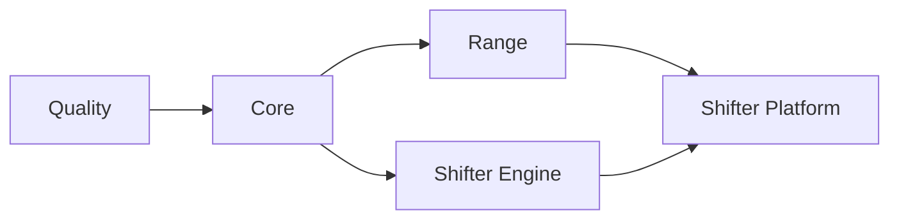

# CI/CD

GitHub Actions with self-hosted runners.

## Workflow Structure

```
.github/workflows/
├── deploy.yml              # Cloud orchestrator (change detection, dependency chain)
├── _quality.yml            # Linting, security scanning
├── _core.yml               # Core infrastructure (ECR, budgets)
├── _range.yml              # Range VPC infrastructure
├── _shifter-engine.yml     # Engine container build and push
├── _shifter-platform.yml   # Portal infrastructure and app deployment
├── _gcp-dev.yml            # GCP CI wrapper over the gcp-deploy commands
├── release-gcp.yml         # GCP release: images, attestations, deployer image (release-please.yml calls it)
├── packer-gcp.yml          # GCP guest image build, validation call, and publication
├── packer-gcp-validate.yml # GCP guest candidate-boot validation (packer-gcp.yml calls it)
├── packer.yml              # AMI builds (AWS)
└── packer-promote.yml      # AMI promotion to prod (AWS)
```

## Deployment Chain



Jobs run only when relevant files change. `deploy.yml` detects changes and triggers appropriate workflows.

## Change Detection

| Job | Triggers On |
|-----|-------------|
| **core** | `platform/terraform/modules/ecr/**`, `platform/terraform/environments/*/*.tf` |
| **range** | `platform/terraform/modules/range/**`, `platform/terraform/environments/*/range/**` |
| **shifter_engine** | `shifter/engine/provisioner/**`, `platform/terraform/environments/*/eks/**` |
| **shifter_platform** | `platform/terraform/modules/portal/**`, `platform/terraform/environments/*/portal/**` (Terraform only) |
| **portal_image** | `shifter/shifter_platform/**`, `shifter/installation/**` (portal image build/deploy, no Terraform) |

## Environment Targeting

Environment deploys are manual (`workflow_dispatch` with an `environment` input);
push and pull_request run validation only (#730).

- Pull request → Quality only
- Push to `dev` / `main` → Quality only; no deploy
- Manual dispatch `environment=aws-dev` → AWS dev deploy

Run a deploy with `gh workflow run deploy.yml --ref <branch> -f environment=<env>`.

## Authentication

OIDC federation per cloud. No long-lived credentials.

| Secret | Purpose |
|--------|---------|
| `AWS_ROLE_ARN` | AWS prod IAM role |
| `AWS_ROLE_ARN_DEV` | AWS dev IAM role |
| `GCP_DEPLOY_SERVICE_ACCOUNT` | Purpose-scoped GCP deploy service account email |
| `GCP_PACKER_BUILD_SERVICE_ACCOUNT` | Purpose-scoped GCE image build service account email (`gcp-image-build`) |
| `GCP_PACKER_VALIDATE_SERVICE_ACCOUNT` | Purpose-scoped GCE image validation service account email (`gcp-image-validate`) |
| `GCP_RELEASE_SCAN_SERVICE_ACCOUNT` | Purpose-scoped GCP release-scan service account email |
| `GCP_WORKLOAD_IDENTITY_PROVIDER` | GCP Workload Identity Federation provider |

AWS roles defined in `platform/terraform/global/iam/github-oidc.tf`. The GCP
WIF provider and the purpose identities come from the
`platform/terraform/gcp/global/cicd-oidc` root. GitHub federation is optional
there: a GCP deployment that runs without GitHub has no WIF provider, and its
operators impersonate the purpose identities instead (ADR-070).

## GCP Current State

No GCP tenant deploys through CI/CD after #2668. GCP tenants install published
releases with the GitHub-less commands (ADR-070). The GCP jobs stay in
`deploy.yml`, but no `environment` option selects them; #2672 decides the future
of that path. When a tenant is wired in, its deployment Environment and the
purpose-scoped `gcp-release-scan-<deployment suffix>` Environment provide their
own exact WIF identity variables. The reusable workflow does not reuse the
deploy identity for release scanning.

The developer build project holds the only GitHub Actions WIF identities in use.
`packer-gcp.yml` builds in the `gcp-image-build` Environment and calls
`packer-gcp-validate.yml` in the `gcp-image-validate` Environment (see
`docs/architecture/gcp-guest-images.md`).

`_gcp-dev.yml` is a thin wrapper over the GitHub-less deploy commands
(ADR-070). Each job renders the deployment input bundle from the GitHub
secrets and variables with `scripts/gcp/render_ci_deployment_inputs.py`, then
runs `scripts/bootstrap/deploy.py`:

| Job | Command |
|-----|---------|
| `validate` | `terraform fmt` and `terraform validate` |
| `prepare` | preflight, `gcp-deploy --stage infrastructure`, then the image build and attestation with `push-to-registry: true` |
| `release_scan` | `gcp-release-scan` as the release-scan identity |
| `deploy` | `gcp-deploy --stage rollout` |
| `post-deploy-smoke` | `gcp-smoke`; a failure opens a GitHub issue |

No GitHub workflow runs `gcp-destroy`. An operator runs it as the destroy
identity (ADR-070).

Every deploy dispatch runs the quality gate before an apply. All GCP
deployments use the shared Terraform root `environments/platform` with the
deployment's own state prefix. The command keeps `TF_DATA_DIR` in a private
directory for each run. The AWS application lifecycle uses EKS and the shared
Helm chart.

The deploy command sets `public_hostname` from `deployment.domain` and sets
`enable_managed_tls = true`. It fails closed unless
`gke_master_authorized_cidrs` is empty for Connect Gateway or contains only
connected RFC1918 networks.

A GCP deployment can also run without GitHub: an operator runs the same
commands from the deployer image of a published release. See the
[GitHub-less GCP deployment guide](../handbook/gcp-github-less-deployment.md).
`gdc-bootstrap` builds only the legacy GDC VM Runtime substrate for the `gdc`
range backend.
